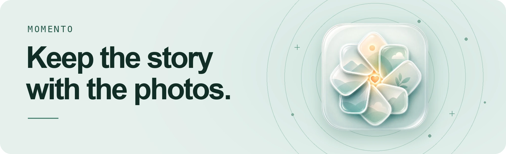
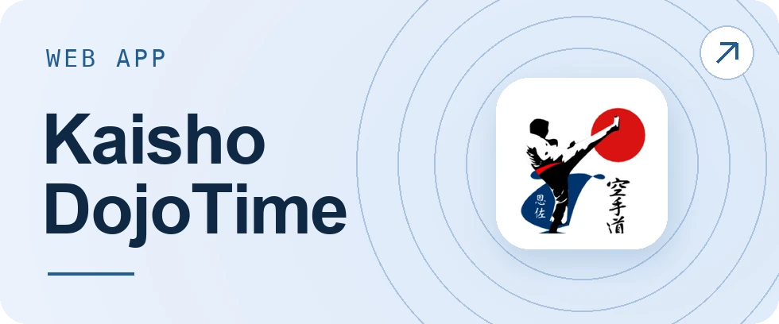
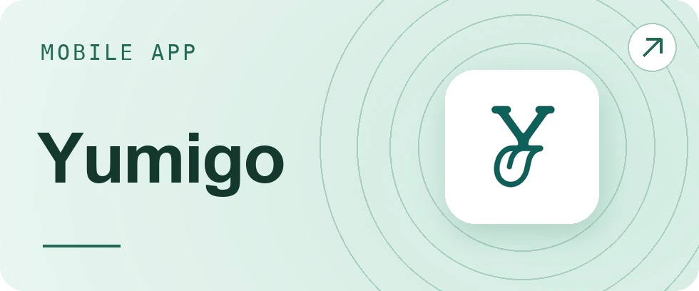
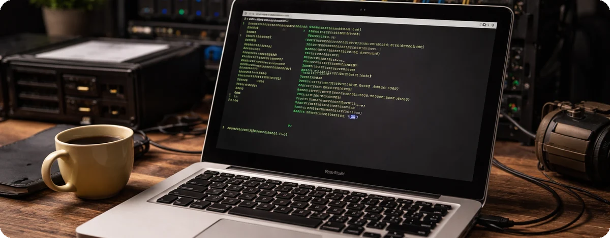

<picture>
  <source media="(prefers-color-scheme: dark)" srcset="assets/profile-dark.webp">
  
</picture>

  <a href="#momento"><kbd>Momento</kbd></a>
  <a href="#projects"><kbd>Projects</kbd></a>
  <a href="#skills"><kbd>Skills</kbd></a>
  <a href="#my-path"><kbd>My path</kbd></a>

I’m an apprentice application developer at **Sunrise** in Zurich and attend the Vocational Baccalaureate School (BMS-W) in Winterthur. I’ve been coding since **2019** and now build across the stack, from the first Figma sketches to backend work and deployment. I care about thoughtful interfaces and code I can still make sense of six months later.

**Open to junior development roles from summer 2028.**

**[Portfolio](https://selina.mogicato.ch/)** · **[LinkedIn](https://www.linkedin.com/in/selina-mogicato-4b7a7637a/)** · **[Email](mailto:selimo.contact@gmail.com)**

## Momento

**Momento** is my first native iOS app, built with Swift. It’s a private photo journal for iPhone and iPad that keeps the story behind a set of photos in one place.

**[Download on the App Store](https://apps.apple.com/ch/app/momento-moments/id6797451975?l=en-GB)** · **[Visit Momento](https://momento.mogicato.ch/)**

<strong>Explore Momento’s features</strong>

- **Build a memory** by adding a story, a date, people, and places to your favourite photos.
- **Revisit it later** by sealing it in a Time Capsule with an opening date.
- **Export to Apple Photos** as a complete album or a selection of your favourite shots.
- **Keep it private** with local storage and an optional device lock for selected moments.

## Projects

  
  

- **Kaisho DojoTime** brings training schedules, instructor assignments, and events together for my karate club. `React` · `TypeScript` · `Supabase`
- **Yumigo** turns cravings into recipe ideas based on what’s local and in season. I started it during my BBC foundation year. `React Native` · `Expo` · `Firebase`

<strong>Inside my HomeLab</strong> · Linux, Docker &amp; Nginx

I use a **2012 MacBook Pro** to self-host personal projects and experiment with containers, reverse proxying, and monitoring.

<strong>More projects</strong> · Vibra, Rummy &amp; my portfolios

- **[Vibra](https://selina.mogicato.ch/vibra)** · A personal music player built with TypeScript and the Spotify Web API.
- **[Rummy](https://rummy.mogicato.ch/)** · A PHP and SQL scoring tool I built for a school project that my family still uses.
- **[Work Portfolio](https://selina.sunrise-avengers.ch/)** · Projects and milestones from my Sunrise apprenticeship, built with React, Tailwind CSS, and Vite.
- **[Personal Portfolio](https://github.com/Selimo100/Portfolio)** · My Next.js and TypeScript site in English, German, and Italian, with an interactive project gallery and a site assistant called Momo.

## Skills

### Coding languages

`Swift` · `TypeScript` · `JavaScript` · `Java` · `Python` · `PHP` · `Rust` · `SQL`

**Markup & styling** · `HTML` · `CSS` · `Markdown`

### Frameworks & tools

<strong>Mobile</strong> · Swift, React Native &amp; Expo

I build native iOS apps and cross-platform mobile apps. Momento is my Swift project for local-first design, and Yumigo is where I worked with React Native, Expo, and Firebase.

<strong>Frontend &amp; design</strong> · TypeScript, React, Next.js, Vue &amp; Figma

I sketch and prototype in Figma, then build responsive interfaces with HTML, CSS, JavaScript, and TypeScript. My toolkit includes Vite, Tailwind CSS, Bootstrap, and React Router.

<strong>Backend &amp; APIs</strong> · Java, Spring Boot, Node.js, Python &amp; PHP

I work with backend services and REST APIs using Spring Boot, Node.js, and Flask. I use Postman and Swagger to work with API requests and documentation.

<strong>Data</strong> · PostgreSQL, MySQL, MongoDB, Redis &amp; Supabase

I’ve worked with SQL and document databases, including MariaDB and SQLite, and with managed services such as Supabase and Firebase.

<strong>Deployment &amp; monitoring</strong> · Linux, Docker, Nginx, Grafana &amp; Prometheus

I work with containers, reverse proxies, and self-hosted deployments. I’ve also deployed projects to Netlify and Vercel.

<strong>Version control &amp; testing</strong> · Git, GitHub, GitLab CI, Vitest &amp; Jest

I use Git and GitLab for version control and CI, Vitest and Jest for JavaScript tests, and Prettier to keep formatting consistent.

## My path

| When | Milestone |
| --- | --- |
| **2026–present** | Application development at **Sunrise GmbH**, covering frontend, backend, and deployment on client systems. |
| **2025–present** | Vocational Baccalaureate (BMS-W) in Winterthur alongside my apprenticeship. |
| **2024–2025** | BBC foundation year, where I learned the fundamentals and built the first version of Yumigo. |
| **2019** | Started programming with websites and small tools for my family. |

**Spoken languages** · German, Italian, English, and French. I’m learning Spanish.

## Beyond the screen

I train and coach children at **Kaisho Karate Bassersdorf**.

**[Play my portfolio mini-game](https://selina.mogicato.ch/en/about/#minigame-headline)** · Recover files in a retro Mac puzzle to learn more about me.

## GitHub activity

**[Explore my repositories](https://github.com/Selimo100?tab=repositories)** · **[Jump to my GitHub activity](https://github.com/Selimo100#js-contribution-activity)**

---

<strong>Structured software, built with care.</strong>

